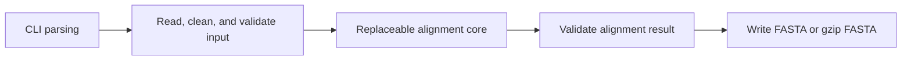

# MSA-Kit

A reusable template for building multiple sequence alignment tools with consistent input/output conventions and command-line interfaces.

MSA-Kit is designed so that developers can copy the project, replace its alignment core, and reuse the surrounding sequence readers, writers, command-line interface, and result checks.

**Version 0.1.0.** The C++ framework, reference star core, build configuration, and synthetic tests are implemented. The reference algorithm is deliberately small and readable, intended for learning and replacement rather than large-scale production alignment. Build and test instructions are below.

## Documentation

| Document | Purpose |
| --- | --- |
| [Design specification](docs/design.md) | The authoritative English specification for architecture, data contracts, CLI behavior, the reference algorithm, and verification. |
| [中文开发指南](docs/guide.zh-CN.md) | 中文介绍程序各层的职责、核心替换步骤、输入输出规则和检查方法。 |
| [Input testing guide](docs/testing.md) | Input-case matrix, expected handling, failure checks, and instructions for extending and reproducing tests. |
| [MIT license](LICENSE) | Terms for using, modifying, and redistributing MSA-Kit. |
| [Third-party notices](THIRD_PARTY_NOTICES.md) | Pinned sources, adapted code, and dependency licenses. |

## Features

- DNA and RNA input in FASTA, including gzip-compressed input and standard input.
- HAlign-style nucleotide cleaning, with explicit errors for pre-existing `-` or `.` gap characters.
- Aligned FASTA or gzip FASTA output, with original record order and complete headers retained.
- A fixed command-line interface, documented exit codes, and logs on standard error.
- A small, in-memory C++ interface for replacing the alignment core.
- A deterministic reference star alignment and small synthetic contract tests.

The supported platform is Linux. The implementation uses C++20 and CMake 3.18 or newer. CLI11 2.6.1, spdlog 1.16.0, and doctest 2.4.12 are bundled at fixed versions; configuration and compilation do not download dependencies. Install a C++20 compiler, CMake, and zlib development files on the system. Tests additionally require Python 3.8 or newer; the executable does not require Python.

## Architecture



The framework retains headers and input order. The core receives prepared sequences and returns aligned rows at the same positions:

```cpp
namespace msakit {

struct SequenceRecord {
    std::string header;
    std::string sequence;
};

struct Alignment {
    std::vector<std::string> rows;
};

Alignment align(std::span<const SequenceRecord> input);

}
```

The declaration is in [include/msakit/core.hpp](include/msakit/core.hpp), with the replaceable implementation in [src/core/star.cpp](src/core/star.cpp).

Every returned row must preserve its corresponding cleaned input sequence when gaps are removed. All rows must have the same length, and no column may consist entirely of gaps. Complete headers and duplicate records are preserved by input position rather than matched through a unique-name map.

## Build and test

From the repository root:

```bash
cmake -S . -B build -DCMAKE_BUILD_TYPE=Release -DBUILD_TESTING=ON
cmake --build build --parallel 2
(cd build && ctest --output-on-failure)
./build/msakit -i examples/tiny.fasta -o build/tiny.aligned.fasta
cmp examples/tiny.expected.fasta build/tiny.aligned.fasta
```

The example output must not already exist unless `--force` is supplied. To build just the executable without test dependencies, configure with `-DBUILD_TESTING=OFF`. An optional install is available through `cmake --install build --prefix <prefix>`.

## Usage

Use `./build/msakit` directly, or `msakit` after installing it on `PATH`:

```bash
msakit -i input.fasta -o aligned.fasta
msakit -i input.fasta.gz -o aligned.fasta.gz
cat input.fasta | msakit -i - -o - > aligned.fasta
```

Input compression is detected from its contents. A named output ending in `.gz` is compressed; `-o -` writes plain aligned FASTA to standard output. Logs go to standard error. Output wraps at 80 characters by default; `--line-width 0` disables wrapping.

Existing output files require `--force`. Input and output must not refer to the same file, even with `--force`. See the design specification for the complete options, error behavior, and output-completion rules.

When chaining multiple programs in Bash, use `set -o pipefail` and check the pipeline status. Shell redirection can leave a partial file on failure; it does not provide the completed-write protection of a named `-o` destination.

## Replacing the reference core

The developer workflow is:

1. Copy or clone MSA-Kit and build the unchanged template.
2. Run its small synthetic tests to check the local setup.
3. Replace the implementation of `msakit::align` in the designated core source file.
4. Keep the input/output contract and rerun the framework contract tests.
5. Add tests for the new algorithm's own scoring, edge cases, and expected behavior.

To run only algorithm-independent checks after replacing the core:

```bash
(cd build && ctest -L contract --output-on-failure)
```

Tests labeled `reference` check the supplied star algorithm's scoring and exact examples; update or replace these for a different algorithm. The default `ctest` command runs both groups.

The supplied core is labeled **Reference star alignment — replaceable core**. It uses the first input sequence as the center, global Needleman–Wunsch pairwise alignment, and a deterministic insertion-slot merge. It is intended for small demonstrations and interface validation; it does not provide HAlign-5's performance or guarantee an optimal multiple alignment. Alternative cores may produce different valid gap layouts.

## Input cleaning at a glance

Accepted lowercase `a/c/g/t/u/n` becomes uppercase. `A/C/G/T/U/N` is preserved, and other sequence bytes become `N`. Pre-existing `-` or `.` causes an input error. FASTA line endings are structural; spaces and tabs within sequence lines follow the byte-cleaning rule and become `N`. Headers are not cleaned.

This cleaning can discard ambiguity information. Output preservation is checked against the cleaned sequences supplied to the core. T and U remain distinct output characters; the reference core treats them as equivalent only when scoring.

## HAlign-5 provenance and licensing

The design is based on [HAlign-5 at commit `b0d5608811d44e30bc323da54f0583ceaaf684d2`](https://github.com/pinglu-zhang/HAlign-5/tree/b0d5608811d44e30bc323da54f0583ceaaf684d2), particularly its CLI organization, reader/writer abstractions, and nucleotide-cleaning table. The design specification records the file-level provenance and intentional changes.

MSA-Kit is distributed under the [MIT license](LICENSE). HAlign-5's copyright and permission notice are retained for the adapted cleaning code. Third-party libraries retain their own license and attribution requirements; [the notices](THIRD_PARTY_NOTICES.md) and [dependency manifest](extern/provenance.json) record the sources and file checksums.

## Verification and limits

The test suite separates framework contracts from reference-core examples and includes a reusable input-case matrix, real subprocess/pipe tests, gzip corruption cases, deterministic file-operation failures, and independent short-pair score checks. [The input testing guide](docs/testing.md) maps input rules to stable case identifiers and explains how to add cases. Sanitizers are available with `-DMSAKIT_ENABLE_SANITIZERS=ON` in a separate Debug build. Actual environment, commands, and results are recorded in [the validation report](docs/validation.md).

The reference core holds the sequences and alignment in memory and uses a full pairwise DP matrix. It supports neither parallel execution nor protein/profile input. Successful output validation establishes structural correctness, not biological accuracy or large-dataset performance.
