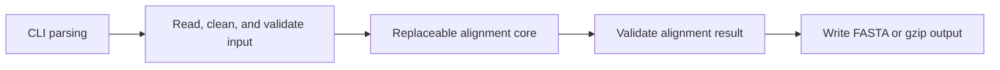

# MSA-Kit design

This document defines the first implementation of MSA-Kit, version 0.1.0. See the
[project overview](../README.md) and [Chinese developer guide](guide.zh-CN.md).
Requirements here describe the implemented public contract. Build instructions
are below; measured validation results are recorded in the
[validation report](validation.md).

## 1. Status and scope

**Current stage: implemented source template.** The repository includes the C++
program, reference core, fixed header-only dependencies, synthetic examples,
and tests. Normal configuration and compilation do not fetch dependencies.

MSA-Kit is a reusable C++ template for DNA and RNA multiple sequence alignment.
It separates ordinary application behavior from a replaceable alignment core.
The first core is a small, deterministic star aligner intended for learning,
interface verification, and replacement by another algorithm.

The first implementation targets Linux, C++20, and CMake 3.18 or later. Its
supported input is unaligned FASTA, either plain or gzip-compressed, from a file
or standard input. Its output is aligned FASTA, optionally gzip-compressed when
written to a file. Sequences are held in memory during alignment.

Protein alignment, FASTQ, URL downloads, profile input, external alignment
commands, dynamic plugins, and parallel execution are outside the first
implementation. The reference algorithm does not inherit HAlign-5's scale or
performance claims.

The source baseline is [HAlign-5 commit
`b0d5608811d44e30bc323da54f0583ceaaf684d2`](https://github.com/pinglu-zhang/HAlign-5/tree/b0d5608811d44e30bc323da54f0583ceaaf684d2).
Section 10 records the provenance and the intended reuse boundaries.

## 2. Architecture



| Layer | Responsibility | Implementation location |
|---|---|---|
| Application | Coordinate the stages and translate failures into exit codes | `src/main.cpp` |
| CLI | Parse arguments; provide help and version output; configure logging | `src/cli.cpp` |
| Input/output | Handle streams, compression, FASTA records, cleaning, and completed writes | `src/io.cpp` |
| Core | Align validated in-memory sequences | `src/core/star.cpp` |
| Result validation | Enforce the algorithm-independent output contract | `src/validation.cpp` |
| Public interface | Declare the record types and the core entry point | `include/msakit/core.hpp` |

The public types are in [core.hpp](../include/msakit/core.hpp), and the replaceable
algorithm is in [star.cpp](../src/core/star.cpp). The core has no
dependency on CLI11, spdlog, filesystem paths, or compression. The surrounding
layers own those concerns. There is one selected core implementation in the
executable, rather than a runtime plugin loader.

The application validates input before calling the core and validates the
complete returned alignment before opening a final output transaction. It keeps
input records available for validation and for writing their original headers.
No raw-input copy or HAlign-style working-directory tree is required.

## 3. Core interface

The public header exposes the following interface:

```cpp
#include <span>
#include <string>
#include <vector>

namespace msakit {

struct SequenceRecord {
    std::string header;
    std::string sequence;
};

struct Alignment {
    std::vector<std::string> rows;
};

Alignment align(std::span<const SequenceRecord> input);

}  // namespace msakit
```

The input vector position is the record identity. `header` contains the complete
FASTA header, without `>` or its line ending. Headers are not unique keys:
duplicate headers and duplicate sequences must remain separate records.
`sequence` contains the cleaned, nonempty sequence, with no gaps. The input
collection must contain at least one record.

The span is a read-only view valid for the duration of the call. The core must
not modify input records, retain views into them after returning, parse command
arguments, read or write files, or write to standard output. Returned strings
own their storage. `rows[i]` corresponds to `input[i]`; the core cannot add,
remove, or reorder records. It returns only aligned strings, leaving all header
handling to the application.

Core failures are reported by exceptions. The application translates a core
exception, allocation failure, or failed result check into exit code 5. It must
not silently select another algorithm or return a truncated alignment.

Before output, the framework checks all of these properties:

1. The result has exactly as many rows as the input has records.
2. Every result row has the same positive length.
3. Removing `-` from row `i` gives exactly `input[i].sequence`.
4. Result characters belong to `A`, `C`, `G`, `T`, `U`, `N`, and `-`.
5. No column contains only gaps.

These checks define valid output, not its biological accuracy. An alternative
algorithm may choose a different valid alignment from the reference core.

## 4. Input contract

### FASTA structure and record identity

Input is a local file path or `-` for standard input. Compression is detected by
the gzip magic bytes, independent of the filename, including for standard
input. The bytes used to detect compression must still reach the parser or
decompressor. A gzip read detects corruption and premature end of stream.
Concatenated gzip members are supported, including empty members; non-gzip
trailing bytes are rejected with exit code 4 rather than silently discarded.

The first nonempty decompressed line must start with `>`. Each such line starts
a new record; subsequent sequence lines are concatenated until the next header.
Truly empty lines add no residues. LF and CRLF are accepted, as is a final line
without a line ending. A space-only sequence line is not an empty line: its
bytes are processed by the cleaning table below.

The text after `>` must contain at least one non-whitespace character. Preserve
the entire header text, including descriptions and repeated names, without
trimming or token-based reconstruction. Only the `>` marker and line ending are
removed. Headers are not passed through sequence cleaning.

An empty input, empty header, empty sequence, or sequence text before the first
header is an input-content error. FASTQ is not automatically accepted by a
general-purpose sequence parser. Malformed content must not be silently skipped.
Errors identify the source and, when available, the one-based record and line.

### Sequence cleaning

Cleaning follows HAlign-5's byte-table approach with an explicit unaligned-input
requirement. First reject every `-` or `.` in sequence content. Then apply this
table to each remaining byte:

| Input byte | Cleaned character |
|---|---|
| `A C G T U N` | Unchanged |
| `a c g t u n` | Corresponding uppercase character |
| Every other byte | `N` |

Line endings are structural and do not reach this table. Spaces, tabs, digits,
other IUPAC ambiguity symbols, and other bytes within sequence lines become
`N`; they are not silently removed. Consequently, this is a byte-based
normalization policy, not Unicode sequence interpretation or protein support.
RNA `U` is preserved and is never rewritten as `T` by the input layer.

The application reports separate totals for accepted lowercase letters changed
to uppercase and other bytes replaced with `N`. The counts are disjoint:
existing `N` is unchanged, and `n` counts only as a case conversion. Quiet mode
suppresses the ordinary summary, but never errors. Gap rejection takes
precedence over cleaning: a gap must not be disguised as an unknown residue.

The sequence used by the core and the result validator is the cleaned sequence.
For example, `acgRyUn` becomes `ACGNNUN`. Its raw input spelling is not the
sequence-preservation reference used to validate the alignment.

## 5. Output contract

The result is FASTA with one record for every input record, in input order. The
application writes `>` followed by the saved complete header. Each aligned row
contains its cleaned input residues and any newly inserted `-` characters.
Duplicate headers and duplicate sequences remain separate output records.

Output uses LF and ends with a newline. Sequence lines are wrapped at 80
characters by default. `--line-width 0` disables sequence wrapping; other
nonnegative widths set the maximum number of characters on each sequence line.
Headers are never wrapped.

A file path ending in the literal suffix `.gz` selects gzip output. Other file
paths select plain FASTA. Output to `-` is always plain FASTA on standard output;
users may pipe it to a compressor. Filename-based output selection is separate
from magic-byte-based input detection.

### Completed file writes

The complete alignment must pass result validation before serialization begins.
For a file destination, create an exclusively owned temporary file in the
destination directory, serialize into it, and explicitly check write, flush,
and close results, including gzip finalization. Publish the completed file only
after those steps succeed. Destructors provide cleanup, not proof of success.

The output parent directory must already exist. The program does not create a
missing parent automatically. Without `--force`, an existing destination is an
error. This no-overwrite rule must also hold if a destination appears between
the initial check and final publication; a check followed by an unconditional
replacement is insufficient. With `--force`, replacement happens only after a
complete temporary file is ready. An unsuccessful run must preserve an existing
destination and remove only temporary files owned by that run.

Input and output must not refer to the same file, even with `--force`. Check
equivalent paths and existing symbolic or hard-link aliases, not merely equal
argument strings. Stream mode cannot reliably detect shell-created aliases;
documentation must not recommend redirecting output onto its input file.

Standard output cannot be rolled back. The program validates the complete
alignment first, but a broken pipe or later write failure can still leave a
partial stream. Detect that failure and return a nonzero status. Only alignment
data is written to standard output during an alignment run. Logs, progress, and
errors go to standard error.

## 6. Command-line interface

The executable name is `msakit`, with this complete first-version
parameter set:

| Parameter | Contract |
|---|---|
| `-i, --input PATH` | Required; local input path or `-` |
| `-o, --output PATH` | Required; output path or `-` |
| `--line-width N` | Nonnegative integer; default 80; 0 disables wrapping |
| `--force` | Permit replacement of an existing output file |
| `--quiet` | Suppress ordinary logs, including normalization summaries; keep errors |
| `-h, --help` | Print help and exit successfully |
| `-v, --version` | Print the program name and version and exit successfully |

Help and version output use standard output and do not require input/output
arguments, read sequence data, or create output files. Unknown options, missing
required options, negative or overflowing widths, and invalid argument
combinations are parameter errors. The first reference core is single-threaded;
there is no `--threads` option or hidden algorithm-tuning option.

Usage examples after building; use `./build/msakit` instead of `msakit` if the
executable has not been installed on `PATH`:

```bash
set -o pipefail
msakit -i input.fasta -o aligned.fasta
msakit -i input.fasta.gz -o aligned.fasta.gz
cat input.fasta | msakit -i - -o - > aligned.fasta
gzip -c input.fasta | msakit -i - -o - | gzip > aligned.fasta.gz
```

The Bash `pipefail` setting makes a failure in an earlier pipeline stage visible
in the pipeline's exit status. Check that status: a failed pipeline can still
leave a compressed partial file created by shell redirection, so file existence
does not establish success. The program's own file-output transaction applies
only when a named output is passed through `-o`.

| Exit code | Meaning and examples |
|---|---|
| 0 | Alignment written successfully, or successful help/version request |
| 2 | CLI error, including invalid width or input/output referring to the same file |
| 3 | Invalid input content, including malformed FASTA, empty records, or existing gaps |
| 4 | Read, decompression, or write failure; missing/unreadable input; missing output parent; overwrite refusal |
| 5 | Core exception, resource allocation failure, or invalid returned alignment |

Do not rely on CLI11's native error codes as the public exit-code contract;
translate parser failures to code 2. Missing or unreadable files and corrupted
or truncated gzip streams belong to code 4. A zero exit status requires a
successfully completed write, not merely a completed alignment calculation.

## 7. Reference star alignment

Mark the implementation entry and its documentation with:

**Reference star alignment — replaceable core**

The first input sequence is the center. Align each remaining sequence against
that same center with global Needleman–Wunsch and linear gap penalties. A single
input record is returned unchanged as a one-row alignment.

### Pairwise scoring and deterministic traceback

For center `c` and query `q`, substitution scoring is defined in this order:

1. If either character is `N`, score 0, including `N` against `N`.
2. If characters are equal, or are the pair `T`/`U`, score +1.
3. Otherwise score -1.

Every gap character scores -1, including terminal gaps. There is no local
clipping, free-end gap, affine-gap option, or reverse-complement search. T/U
equivalence changes only scoring; the aligned strings retain their original
cleaned `T` or `U` characters.

Let `i` and `j` be the numbers of consumed center and query characters:

```text
D(0, 0) = 0
D(i, 0) = -i
D(0, j) = -j
D(i, j) = max(
    D(i-1, j-1) + substitution(c[i-1], q[j-1]),
    D(i-1, j) - 1,
    D(i, j-1) - 1
)
```

Start traceback at the final cell. Equal-score choices use the following order:
diagonal (consume both), up (consume center only, insert a query gap), then left
(consume query only, insert a center gap). Apply the same definitions at matrix
boundaries where only one move is possible. Reverse the collected traceback
strings before extracting insertion slots. For center `A` and query `AA`, this
tie rule produces `-A` and `AA`.

### Merging pairwise alignments

A center of length `L` has `L+1` insertion slots. Slot `s` is the position after
consuming `s` center residues: slot 0 is the prefix, slot `L` is the suffix.
For each pairwise alignment, collect the query character or gap at each center
residue and the query insertion string in each slot, preserving residue order.

Set each slot's width to the maximum insertion-string length across queries.
Write the output in this order: slot 0, center position 0, slot 1, center
position 1, and so on through the final slot. A query's insertion string is
left-aligned in its slot and padded on the right with gaps. The center contains
gaps throughout every insertion slot and is written exactly once.

For example, these synthetic sequences give the following reference result:

```text
Input                  Aligned rows
center  AC             center  A--C
q1      ATC            q1      AT-C
q2      AGGC           q2      AGGC
```

Insertion strings sharing a slot are not aligned against one another. This is
a deterministic teaching merge, not a claim of optimal insertion homology or
optimal multiple sequence alignment.

### Cost and failure boundaries

Let `n` be the sequence count, `L` the center length, `m_i` each query length,
and `W` the final alignment width. Pairwise calculation costs
`O(L × sum(m_i))` time; construction and validation add `O(n × W)`. Process
queries sequentially and release each pairwise DP table before the next one.
The largest full DP table occupies `O((L+1) × (max(m_i)+1))` space; inputs,
stored pairwise/slot information, and the final `O(n × W)` matrix also consume
memory. Do not describe DP space alone as total memory use.

Use a signed score representation. Check matrix-dimension multiplication,
score bounds, and output-length accumulation before allocation or arithmetic
can overflow. Resource exhaustion is an explicit failure, not permission to
truncate data or switch scoring or algorithms. This reference core is intended
for small demonstrations and contract tests.

## 8. Replacing the core

A developer replacing the supplied core should:

1. Copy or clone the project and build its unchanged reference implementation.
2. Read the public interface and result conditions in section 3.
3. Replace the marked `align` implementation in `src/core/star.cpp`, retaining
   the public declaration. Additional private algorithm helpers may be added;
   update the build inputs if extra translation units are introduced.
4. Keep CLI parsing, input cleaning, header handling, output writing, and result
   validation in the shared layers.
5. Run the common contract tests with `(cd build && ctest -L contract --output-on-failure)`, add algorithm-specific tests, and update the
   algorithm description and dependency notices.

The replacement may choose another center, scoring system, or alignment
strategy. It must preserve row-to-input correspondence and cleaned residues.
Common tests must not require its gap layout to match the reference star core.
Reference-core-specific expected alignments are tests of that implementation,
not constraints on every future algorithm. CTest labels these groups `contract`
and `reference`; the unfiltered test command runs both. New public parameters or input
semantics require an explicit extension of the shared interface documentation;
they must not be introduced by parsing arguments inside the core.

## 9. Verification plan

All tests use small synthetic fixtures. Module tests use doctest, and integration
tests launch the actual executable through Python's standard library. The
following table describes coverage; the validation report records actual runs.

The [input testing guide](testing.md) maps individual input rules to stable case
identifiers, cross-channel checks, and instructions for reproducing failures.
The shared input-case catalog contains expected records and conversion counts
independently of the production parser. Generated inputs use a fixed seed.

| Area | Required scenarios |
|---|---|
| FASTA structure | LF/CRLF, multiline records, no final newline, empty lines, empty file/header/sequence, data before first header, FASTQ rejection |
| Identity | Descriptions and header spacing, duplicate headers, duplicate sequences, original order |
| Cleaning | Accepted lowercase letters, ambiguity symbols, spaces/tabs, disjoint conversion counts, retained U, rejection of both `-` and `.` |
| Compression and streams | Plain and gzip files, both stdin forms, magic detection independent of suffix, truncated/corrupt gzip, plain stdout, gzip output |
| Serialization | Width 80, another positive width, width 0, LF and final newline, headers never wrapped |
| CLI and failures | Help/version without data, missing/unknown options, invalid widths, all exit-code categories, quiet mode, stderr-only diagnostics |
| File lifecycle | Existing output with/without force, same-file path/symlink/hard-link aliases, missing parent, write/flush/close failure, broken pipe, preservation of an existing target on failure |
| Core contract | Substitute test cores returning too few rows, unequal widths, reordered distinct sequences, altered residues, extra characters, and all-gap columns |
| Reference core | One sequence, identical sequences, prefix/internal/suffix insertions, deletion, different insertion lengths in one slot, N, T/U, fixed ties, repeatability |
| Resource boundaries | Checked dimensions and lengths, allocation failure reporting, no successful partial result |

The build target is `msakit`; its executable is `build/msakit` for the
single-configuration build below. Tests are registered with CTest and use
doctest. From the repository root:

```bash
cmake -S . -B build -DCMAKE_BUILD_TYPE=Release -DBUILD_TESTING=ON
cmake --build build --parallel 2
(cd build && ctest --output-on-failure)
./build/msakit --help
```

An instrumented Debug build uses the same tests:

```bash
cmake -S . -B build-sanitize -DCMAKE_BUILD_TYPE=Debug \
  -DBUILD_TESTING=ON -DMSAKIT_ENABLE_SANITIZERS=ON
cmake --build build-sanitize --parallel 2
(cd build-sanitize && ctest --output-on-failure)
```

Tests additionally require Python 3.8 or later; configure with
`-DBUILD_TESTING=OFF` to build without Python or test executables. The program
does not require Python at runtime. The `msakit_support` target contains the
shared CLI, I/O, and validation layers; `msakit_core` contains the replaceable
reference implementation; `msakit` links both.

File-operation fault injection is confined to internal interfaces and test
executables. It covers short/interrupted reads and writes, read/close failures,
gzip finalization, publication, and allocation errors without adding public
testing switches. Normal builds use the same code paths with real system calls.
Tests also check independent exhaustive short-pair optimal scores and verify
the reference algorithm's deterministic examples. Structural validity remains
separate from biological accuracy, and synthetic tests are not a performance
benchmark.

Keep documentation links, parameter and type names, cleaning examples, and exit
codes synchronized with implementation. The actual commands and environment
used for acceptance are in [validation.md](validation.md).

## 10. HAlign-5 provenance and dependencies

All source links below are pinned to the baseline commit rather than a moving
branch. The byte-cleaning table is adapted from that revision; the surrounding
implementation follows MSA-Kit's more explicit contract. Bundled dependency
headers are copied unchanged from the pinned snapshot.

| HAlign-5 source | MSA-Kit treatment |
|---|---|
| [CMakeLists.txt](https://github.com/pinglu-zhang/HAlign-5/blob/b0d5608811d44e30bc323da54f0583ceaaf684d2/CMakeLists.txt) | Retain C++20/CMake organization; make the dependency set small and zlib required; use a common CTest integration |
| [include/config.hpp](https://github.com/pinglu-zhang/HAlign-5/blob/b0d5608811d44e30bc323da54f0583ceaaf684d2/include/config.hpp) | Adapt CLI11 registration and logging organization; keep only the documented general options and send logs to stderr |
| [include/utils.h](https://github.com/pinglu-zhang/HAlign-5/blob/b0d5608811d44e30bc323da54f0583ceaaf684d2/include/utils.h) | Adapt byte-table cleaning; reject pre-existing gaps; use explicit complete headers and positional identity instead of header-keyed maps |
| [src/utils/seq_io.cpp](https://github.com/pinglu-zhang/HAlign-5/blob/b0d5608811d44e30bc323da54f0583ceaaf684d2/src/utils/seq_io.cpp) | Reuse buffered-reader/writer organization where suitable; implement the exact FASTA/header/stream contract and explicit completed-write checks rather than copy unchanged |
| [src/utils/preprocess.cpp](https://github.com/pinglu-zhang/HAlign-5/blob/b0d5608811d44e30bc323da54f0583ceaaf684d2/src/utils/preprocess.cpp) | Keep a separate preparation stage; omit consensus selection, downloads, work-directory trees, and external tool invocation |
| [include/align.h](https://github.com/pinglu-zhang/HAlign-5/blob/b0d5608811d44e30bc323da54f0583ceaaf684d2/include/align.h) | Replace algorithm-specific interfaces with the small in-memory API; do not carry over WFA2/KSW2, sketches, profiles, or SAM intermediates |
| [test/test_read_fasta.cpp](https://github.com/pinglu-zhang/HAlign-5/blob/b0d5608811d44e30bc323da54f0583ceaaf684d2/test/test_read_fasta.cpp) and [test/test_fasta_writer.cpp](https://github.com/pinglu-zhang/HAlign-5/blob/b0d5608811d44e30bc323da54f0583ceaaf684d2/test/test_fasta_writer.cpp) | Adapt small reader/writer test patterns; create isolated synthetic fixtures rather than inherit the entire existing test workload |

The dependencies are bundled CLI11 2.6.1 for argument parsing, spdlog 1.16.0 for
diagnostics, doctest 2.4.12 for tests, and the required system zlib library for
gzip. The reference alignment itself uses the C++
standard library. No external MSA executable, OpenMP runtime, WFA2, KSW2,
MinHash, cereal, or libcurl is required for this template. The source revision,
license sources, and SHA-256 for each bundled file are recorded in
[extern/provenance.json](../extern/provenance.json).

MSA-Kit adopts the [MIT license](../LICENSE). HAlign-5 is also distributed under
the [MIT license](https://github.com/pinglu-zhang/HAlign-5/blob/b0d5608811d44e30bc323da54f0583ceaaf684d2/LICENSE),
with the notice `Copyright (c) 2026 HAlign-5 contributors`. Preserve that notice
and permission text in copied or substantially adapted code. Third-party
libraries retain their own licenses and notices; the MSA-Kit MIT license does
not replace them. [THIRD_PARTY_NOTICES.md](../THIRD_PARTY_NOTICES.md) identifies
the adapted code, copied headers, upstream revisions, and retained license files.
